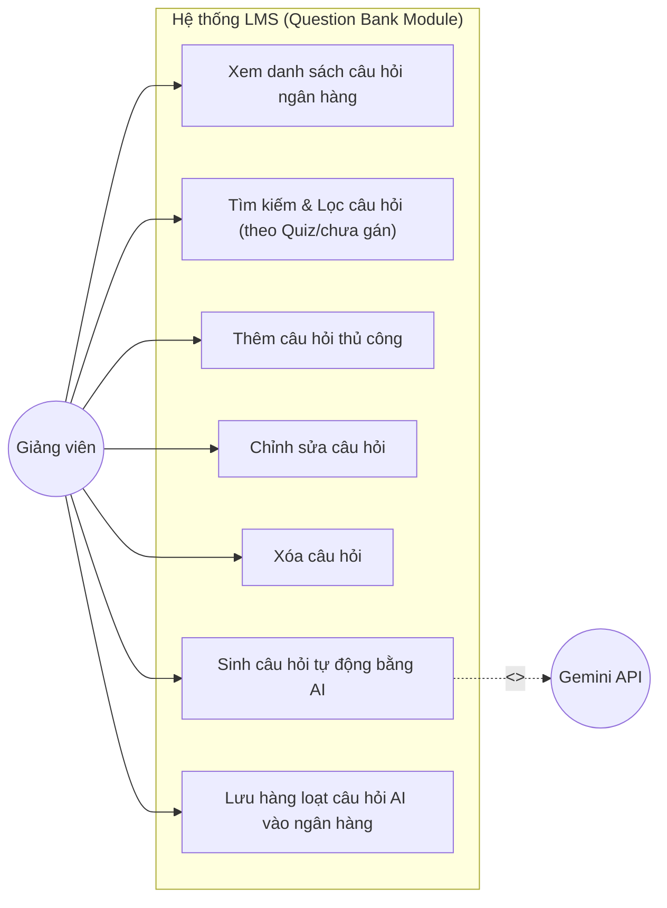
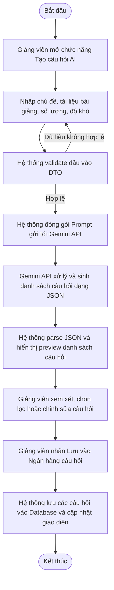
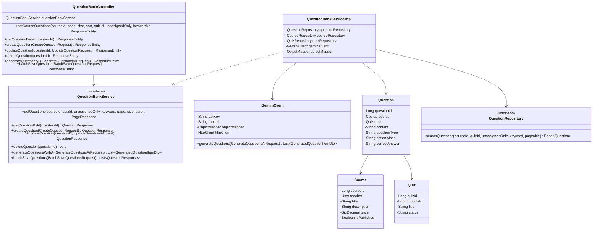
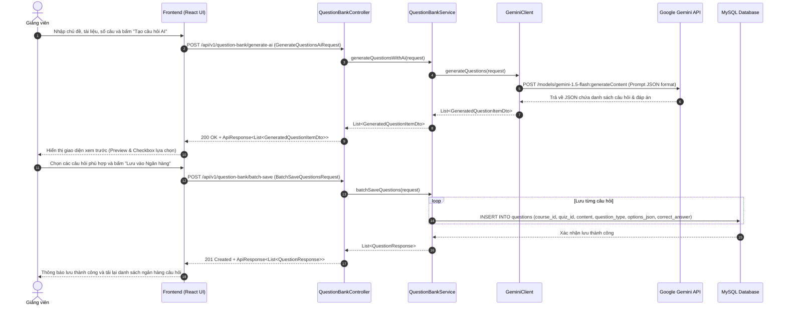

# Thiết kế Phân hệ Quản lý Ngân hàng câu hỏi (Manage Question Bank) - LMS Group 6

Tài liệu thiết kế và đặc tả kỹ thuật cho chức năng số 3: **Manage Question Bank** (External Entities: **Teacher**, **Gemini API**), tuân thủ hướng dẫn chuẩn hóa API trong `docs/API_COMMON.md` và lược đồ cơ sở dữ liệu `database/lms_g6_quiz_random.sql`.

---

## 1. Use Case Diagram (UC-03: Manage Question Bank)



---

## 2. Activity Diagram (External-Integrated: Sinh câu hỏi qua Gemini API)



---

## 3. Class Diagram (Phân hệ Manage Question Bank)



---

## 4. Sequence Diagram (External-Integrated: Sinh câu hỏi qua Gemini API)



---

## 5. Đặc tả API Endpoints

| Method | Endpoint | Mô tả | Mã thành công |
|---|---|---|---|
| `GET` | `/api/v1/courses/{courseId}/questions` | Lấy danh sách câu hỏi (phân trang, lọc theo quiz, tìm kiếm keyword) | `200 OK` (PageResponse) |
| `GET` | `/api/v1/questions/{questionId}` | Lấy chi tiết một câu hỏi | `200 OK` |
| `POST` | `/api/v1/questions` | Tạo một câu hỏi mới thủ công | `201 Created` |
| `PUT` | `/api/v1/questions/{questionId}` | Cập nhật nội dung câu hỏi | `200 OK` |
| `DELETE`| `/api/v1/questions/{questionId}` | Xóa câu hỏi khỏi ngân hàng | `204 No Content` |
| `POST` | `/api/v1/question-bank/generate-ai` | Gọi Gemini API tự động sinh câu hỏi theo chủ đề | `200 OK` |
| `POST` | `/api/v1/question-bank/batch-save` | Lưu hàng loạt câu hỏi được duyệt từ AI vào ngân hàng | `201 Created` |


## Chạy sau khi tích hợp với enrollment

Mặc định ứng dụng dùng MySQL theo backend/.env, ddl-auto: none, schema database/lms_g6_v4.sql. Không tự seed khi startup.

Nếu cần giữ cách demo Question Bank bằng H2 và DataInitializer, bật profile questionbank-demo:

```powershell
mvn -f backend/pom.xml spring-boot:run "-Dspring-boot.run.profiles=questionbank-demo"
```

Profile này dùng database in-memory riêng, dữ liệu mất khi dừng ứng dụng. Không dùng H2 demo để kiểm tra giao dịch SePay Live. Menu Ngân hàng câu hỏi nằm cạnh Khóa học; các route /question-bank và /questions được giữ.
